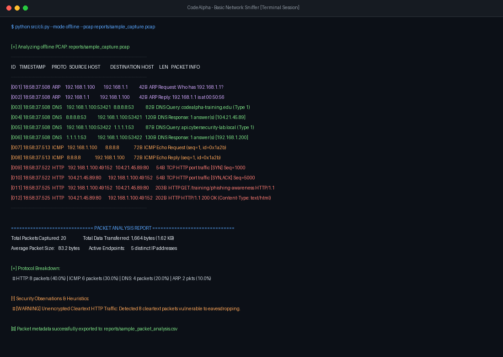

# CodeAlpha Cybersecurity Internship - Task 1: Basic Network Sniffer

A Python-based network packet analyzer and protocol telemetry tool engineered with **Scapy**, **Tabulate**, **Colorama**, and **Flask**. Designed for defensive security auditing, traffic inspection, and network diagnostics.



---

## 🛡️ Project Highlights & Features

1. **Multi-Protocol Deep Inspection**:
   - Accurately dissects and identifies:
     - **Ethernet & ARP** (Hardware addressing and ARP resolution)
     - **IP Layer** (IPv4 and IPv6 source/destination addressing)
     - **Transport Layer** (TCP flags: SYN, ACK, FIN, PSH, RST, URG; UDP lengths and ports)
     - **Application Layer** (HTTP GET/POST methods & status lines, DNS queries/responses, HTTPS/TLS sessions, NTP telemetry)
2. **Comprehensive Packet Metadata**:
   - Frame ID, microsecond timestamp, protocol type, source IP:port, destination IP:port, packet length (bytes), and summary details.
3. **Dynamic Filtering Engine**:
   - Filter stream by Protocol (`TCP`, `UDP`, `ICMP`, `DNS`, `HTTP`), specific IP, or port number.
4. **Traffic Statistics & Anomaly Heuristics**:
   - Total packets, total bandwidth transferred, average frame size, protocol percentage distribution, Top Talkers (source hosts), top destinations, and heuristic security alerts (e.g., cleartext HTTP detection, dominant traffic bursts).
5. **Interactive CLI & Web Dashboard**:
   - Dynamic ANSI-colored terminal console with tabular reports.
   - Modern, dark-themed Flask cybersecurity web dashboard (`http://127.0.0.1:5000`).
6. **Data Export**:
   - Direct export to standardized CSV (`reports/sample_packet_analysis.csv`) and raw PCAP format.
7. **Privacy & Legal Protection Engine**:
   - Explicit user authorization prompt required before live capture.
   - Built-in regex redactor strips passwords, authentication tokens, cookies, and sensitive payloads from display and export.
   - Offline PCAP replay mode for safe evaluation in lab environments.

---

## 📁 Project Structure

```
Task1_Network_Sniffer/
│
├── src/
│   ├── sniffer.py              # Core capture engine & packet parser
│   ├── analyzer.py             # Statistical traffic analyzer & anomaly heuristics
│   ├── generator.py            # Synthetic authorized PCAP generator
│   ├── cli.py                  # Interactive CLI and argument parser
│   ├── web_dashboard.py        # Flask-based web inspection dashboard
│   ├── main.py                 # Primary entry point
│   ├── test_sniffer.py         # Automated unit & integration test suite
│   └── capture_screenshots.py  # Visual evidence generator
│
├── reports/
│   ├── TASK1_REPORT.md         # Comprehensive technical submission report
│   ├── sample_capture.pcap     # Generated authorized sample traffic
│   └── sample_packet_analysis.csv # Exported packet metadata
│
├── screenshots/
│   ├── terminal_packet_analysis.png # Terminal CLI packet analysis proof
│   └── web_dashboard_telemetry.png  # Web dashboard telemetry preview
│
├── requirements.txt            # Python dependencies
└── README.md                   # Documentation & execution guide
```

---

## ⚙️ Installation & Setup (Windows 10/11)

### 1. Prerequisites
- Python 3.10+ (Python 3.12 recommended)
- Standard PowerShell or Command Prompt

### 2. Environment Setup
```powershell
# Navigate to the project directory
cd CodeAlpha_Cybersecurity_Internship\Task1_Network_Sniffer

# Create a virtual environment
python -m venv .venv

# Activate the virtual environment
.\.venv\Scripts\Activate.ps1

# Install project dependencies
pip install -r requirements.txt
```

### 3. Windows Live Capture Note (Npcap)
- For **Offline PCAP analysis**, no special drivers are required.
- For **Live network card sniffing** on Windows, install [Npcap](https://npcap.com/#download) with the option **"Install Npcap in WinPcap API-compatible Mode"** enabled, and run PowerShell as Administrator.

---

## 🚀 Execution Instructions

### Mode 1: Interactive Terminal Menu
```powershell
python src/cli.py
```
This presents an interactive menu to choose between offline analysis, generating test traffic, running live capture, filtering, exporting CSV, and launching the web dashboard.

### Mode 2: Safe Offline PCAP Analysis (Direct Command)
```powershell
python src/cli.py --mode offline --pcap reports/sample_capture.pcap --export-csv reports/sample_packet_analysis.csv
```

### Mode 3: Generate Fresh Sample Traffic
```powershell
python src/generator.py
```

### Mode 4: Launch Web Security Dashboard
```powershell
python src/web_dashboard.py
```
Open your browser to: `http://127.0.0.1:5000`

### Mode 5: Live Interface Capture (Requires Authorization & Admin)
```powershell
python src/cli.py --mode live --count 30 --filter "tcp or udp" --authorized
```

---

## 🧪 Automated Testing

Execute the test suite to verify all components:
```powershell
python src/test_sniffer.py
```
**Test Results**: 7/7 tests passing (`test_01_pcap_generation`, `test_02_packet_parsing`, `test_03_protocol_diversity`, `test_04_privacy_sanitization`, `test_05_filtering`, `test_06_csv_export`, `test_07_traffic_analyzer`).

---

## ⚖️ Ethical & Legal Disclaimer
This tool is developed strictly for educational, defensive cybersecurity training, and authorized security assessments. Capturing network packets on networks without explicit, written permission from the network owner is illegal under cybercrime statutes (e.g., Computer Fraud and Abuse Act, Wiretap Act, IT Act 2000). Always obtain explicit authorization before capturing network communications.
