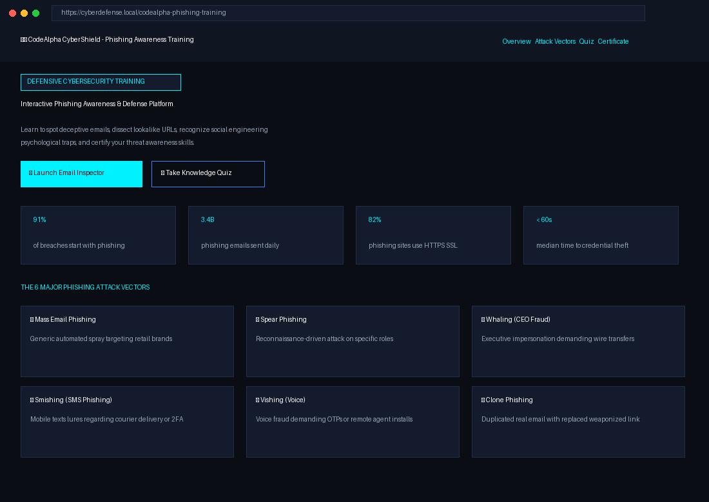

# CodeAlpha Cybersecurity Internship - Task 2: Phishing Awareness Training Platform

An interactive cybersecurity awareness and training web application designed with modern HTML5, CSS3, and JavaScript. Engineered with a dark-theme SOC telemetry dashboard aesthetic to train employees, interns, and students to recognize, analyze, and thwart sophisticated phishing attacks.



---

## 🛡️ Project Highlights & Features

1. **Cybersecurity Operations Center (SOC) Aesthetic**:
   - Modern dark design, responsive cards, glowing neon accents, and smooth animations.
2. **Comprehensive Attack Vector Taxonomy**:
   - In-depth interactive coverage of the 6 major phishing types:
     - **Email Phishing**: Mass spray attacks targeting consumer brands.
     - **Spear Phishing**: Targeted OSINT-based campaigns tailored to specific personnel.
     - **Whaling (CEO Fraud / BEC)**: Executive impersonation demanding urgent wire transfers.
     - **Smishing**: SMS fraud exploiting delivery notifications and 2FA lures.
     - **Vishing**: Voice social engineering impersonating technical support or banks.
     - **Clone Phishing**: Duplicating legitimate historic emails with weaponized links.
3. **Interactive Email Inspector (Hotspot Analyzer)**:
   - 3 realistic fictional attack scenarios (Streaming Account Suspension, IT Password Expiry, Whaling Wire Transfer).
   - "Highlight Red Flags" interactive toggle switch. Clicking red flag badges pops up immediate forensic analysis explaining why that element is deceptive.
4. **URL Anatomy & Typosquatting Laboratory**:
   - Visual breakdown of registered domains, spoofed subdomains, and malicious paths.
   - Debunks the popular myth that "HTTPS Padlock = Safe Website".
5. **Psychological Manipulation Breakdown**:
   - Explains the 6 cognitive persuasion vectors: Urgency, Fear, Authority, Scarcity, Curiosity, and Helpfulness.
6. **10-Question Certification Quiz**:
   - Randomized scenario-based questions assessing real-world discernment.
   - Real-time scoring, instant color-coded feedback, and detailed technical explanations for every option.
7. **Personalized Certificate of Completion**:
   - Dynamic certification generator with student name input, accreditation badge, and printable/save-to-PDF layout.
8. **Cybersecurity Best Practices Checklist**:
   - 8 defensive golden rules for enterprise and personal cyber hygiene.

---

## 📁 Project Structure

```
Task2_Phishing_Awareness/
│
├── index.html                  # Main responsive single-page web application
│
├── css/
│   └── style.css               # Modern dark cybersecurity stylesheet
│
├── js/
│   └── app.js                  # Interactive scenario logic, quiz engine & certificate generator
│
├── screenshots/
│   ├── phishing_awareness_landing.png      # Hero landing and metrics overview
│   ├── interactive_email_inspector.png    # Interactive red flag analysis preview
│   └── phishing_quiz_and_certificate.png  # Completed quiz & certificate accreditation
│
├── TASK2_REPORT.md             # Comprehensive technical submission report
└── README.md                   # Installation and usage instructions
```

---

## 🚀 How to Run on Windows 10/11

The training platform is built with pure client-side standard technologies and requires zero third-party framework installation.

### Option A: Direct Browser Launch (Fastest)
1. Navigate to the project folder:
   ```powershell
   cd CodeAlpha_Cybersecurity_Internship\Task2_Phishing_Awareness
   ```
2. Double-click `index.html` or open it directly via PowerShell:
   ```powershell
   Invoke-Item index.html
   ```
   or:
   ```powershell
   Start-Process msedge.exe index.html
   # or
   Start-Process chrome.exe index.html
   ```

### Option B: Local Python HTTP Web Server
To simulate production web hosting:
```powershell
# In the Task2_Phishing_Awareness directory:
python -m http.server 8080
```
Open your web browser and navigate to:
```
http://127.0.0.1:8080
```

---

## 🧪 Testing & Verification Checklist

- [x] Responsive layout verified across desktop, tablet, and mobile viewport widths.
- [x] Email Inspector scenario tabs switch seamlessly.
- [x] Red flag toggle switch activates and deactivates threat hotspots.
- [x] Clicking red flags displays accurate forensic analysis.
- [x] All 10 quiz questions evaluate answers, update scores, and reveal technical explanations.
- [x] Passing score threshold displays the Certificate of Completion.
- [x] Participant name customization immediately reflects on the certificate.
- [x] Print button triggers clean, printable certificate layout.

---

## ⚖️ Safety & Ethical Disclaimer
All emails, names, phone numbers, and domains presented in this training platform are strictly fictional simulated artifacts. No external emails are transmitted, no real credentials are requested or stored, and no malicious infrastructure is deployed.
