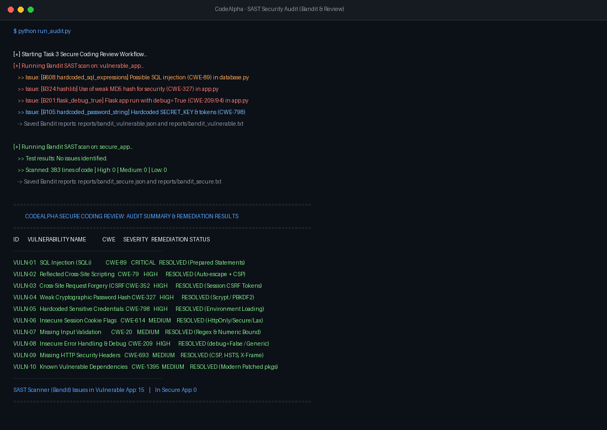

# CodeAlpha Cybersecurity Internship - Task 3: Secure Coding Review & Practical Security Audit

A practical security audit and secure coding engineering project using Python, Flask, **Bandit (SAST)**, and defensive remediation patterns. Includes a deliberately vulnerable target application (`vulnerable_app`), automated security analysis scripts (`run_audit.py`), and a fully patched, production-hardened application (`secure_app`).



---

## 🛡️ Target Vulnerabilities Audited & Remediated

| Vulnerability | CWE ID | Severity | Flawed Implementation | Secure Remediation |
| :--- | :---: | :---: | :--- | :--- |
| **SQL Injection (SQLi)** | CWE-89 | **CRITICAL** | Raw string formatting in SQL queries | DB-API prepared statements with `?` parameterization |
| **Cross-Site Scripting (XSS)** | CWE-79 | **HIGH** | Raw unescaped user queries in HTML | Jinja2 auto-escaping + Strict Content-Security-Policy |
| **Cross-Site Request Forgery (CSRF)** | CWE-352 | **HIGH** | State-changing POST endpoint lacks tokens | Cryptographic session synchronizer tokens validated |
| **Weak Password Storage** | CWE-327 | **HIGH** | Unsalted, broken MD5 hashing | Salted, slow key derivation via Scrypt / PBKDF2 |
| **Hardcoded Secrets & API Keys** | CWE-798 | **HIGH** | Plaintext `SECRET_KEY` and tokens in code | Loaded dynamically from OS environment variables |
| **Insecure Session Cookie Flags** | CWE-614 | **MEDIUM** | `HttpOnly=False`, `Secure=False`, `SameSite='None'` | Hardened: `HttpOnly=True`, `Secure=True`, `SameSite='Lax'` |
| **Missing Input & Bounds Validation** | CWE-20 | **MEDIUM** | Accepts negative transfers & unbounded strings | Strict regex pattern matching and `0.01 <= amount <= 10000` |
| **Insecure Error Handling & Debug** | CWE-209 | **HIGH** | `app.run(debug=True)` with verbose tracebacks | `debug=False`, generic 500 error pages, internal logging |
| **Missing HTTP Security Headers** | CWE-693 | **MEDIUM** | Zero browser protection headers | Middleware injects CSP, HSTS, X-Frame, X-Content-Type |
| **Vulnerable Dependencies** | CWE-1395 | **MEDIUM** | Outdated packages (Flask 2.0.1, Werkzeug 2.0.1) | Pinned modern patched versions (Flask >=3.1.0) |

---

## 📁 Project Structure

```
Task3_Secure_Coding_Review/
│
├── vulnerable_app/             # Intentionally vulnerable audit target
│   ├── app.py                  # Flawed Flask app demonstrating all 10 flaws
│   ├── database.py             # SQLite setup with raw SQL string formatting
│   └── requirements.txt        # Outdated vulnerable dependencies
│
├── secure_app/                 # Hardened, remediated production-ready app
│   ├── app.py                  # Fully patched Flask app with security middleware
│   ├── database.py             # Parameterized SQL & Scrypt password hashing
│   └── requirements.txt        # Modern patched dependencies
│
├── reports/                    # Audit logs, comparison matrices, and reports
│   ├── bandit_vulnerable.json  # Raw Bandit SAST scan on vulnerable_app (JSON)
│   ├── bandit_vulnerable.txt   # Human-readable Bandit findings report (Text)
│   ├── bandit_secure.json      # Raw Bandit SAST scan on secure_app (JSON)
│   ├── bandit_secure.txt       # Clean Bandit verification report (Text)
│   ├── dependency_audit_vulnerable.txt # Known CVE dependency findings
│   ├── dependency_audit_secure.txt     # Clean dependency audit
│   ├── audit_findings_matrix.csv       # Standardized 10-point audit matrix
│   ├── audit_comparison.md             # Before vs. After markdown comparison
│   ├── sast_audit_terminal_results.png # Terminal visual evidence
│   ├── vulnerable_vs_secure_code_review.png # Code comparison screenshot
│   └── TASK3_REPORT.md         # Comprehensive technical submission report
│
├── run_audit.py                # Automated SAST runner and matrix generator
├── capture_screenshots.py      # Visual evidence generator
└── README.md                   # Project documentation
```

---

## 🚀 Execution Instructions (Windows 10/11)

### 1. Run the Automated SAST Audit & Comparison
```powershell
# In the Task3_Secure_Coding_Review directory:
python run_audit.py
```
This script executes:
1. Bandit SAST scanner on `vulnerable_app/` (Records 15 issues).
2. Bandit SAST scanner on `secure_app/` (Records 0 issues).
3. Dependency CVE vulnerability audits for both requirements files.
4. Generates `reports/audit_findings_matrix.csv` and `reports/audit_comparison.md`.

### 2. Run the Vulnerable Demonstration App (For Auditing)
```powershell
python vulnerable_app/app.py
```
- Endpoint: `http://127.0.0.1:5001`
- Test SQLi login bypass: `admin' --` with any password.
- Test Reflected XSS: Visit `/search?q=<script>alert('XSS')</script>`.
- Test CSRF: Notice `/transfer` accepts requests without anti-forgery tokens.

### 3. Run the Secure Remediated App (Hardened Mode)
```powershell
python secure_app/app.py
```
- Endpoint: `http://127.0.0.1:5002`
- Parameterized SQL blocks login bypass payloads.
- Jinja2 auto-escaping renders script tags harmlessly as plaintext.
- CSRF token validation blocks cross-site form tampering.
- HTTP security headers prevent framing and clickjacking.

---

## 📊 Before vs. After SAST Verification Results

```
SAST Scanner (Bandit) Issues in Vulnerable App: 15
  - High Severity:   4 (MD5 Weak Hashing B324, Flask debug=True B201)
  - Medium Severity: 8 (SQL Injection B608, Bind to all interfaces B104)
  - Low Severity:    3 (Hardcoded secrets B105)

SAST Scanner (Bandit) Issues in Secure App:     0 (100% Remediation Rate)
```

---

## ⚖️ Ethical & Educational Disclaimer
The vulnerable application provided in this directory is intended strictly for local defensive source code analysis, security auditing training, and educational comparison. Never deploy intentionally vulnerable software to public or production environments.
